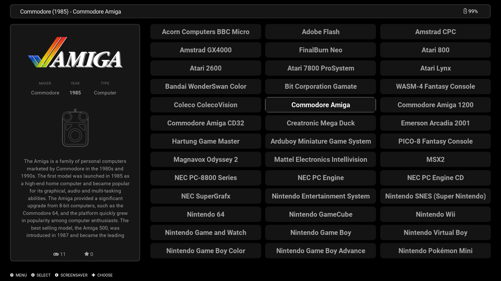
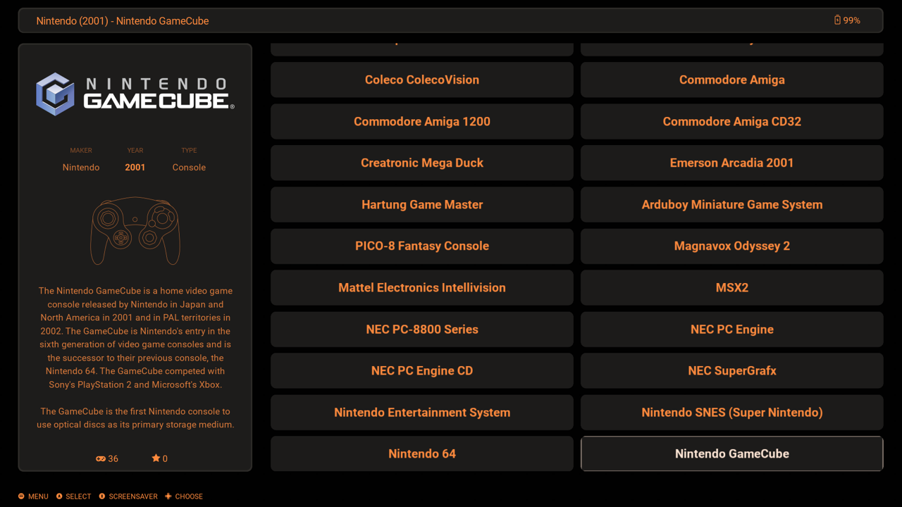
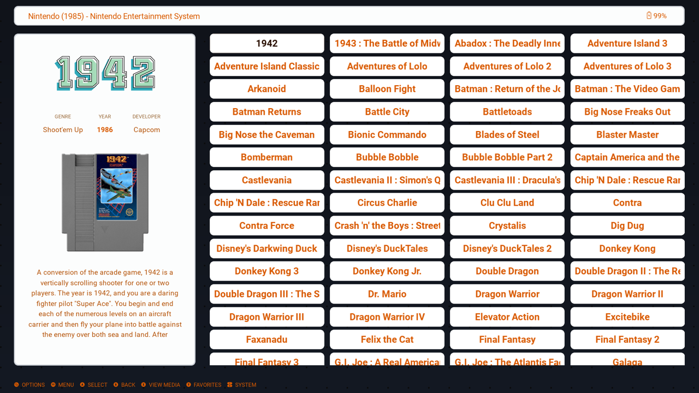
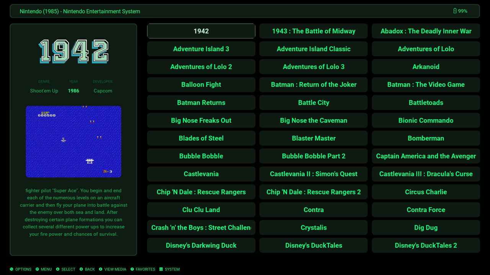
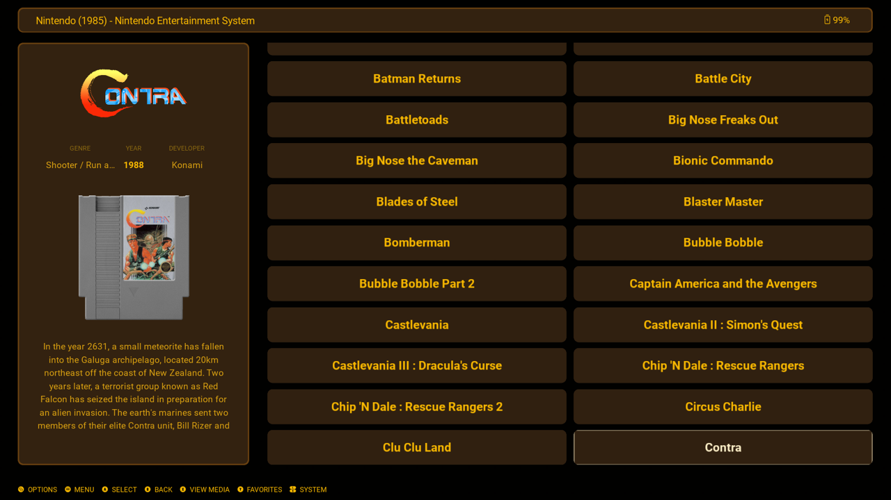
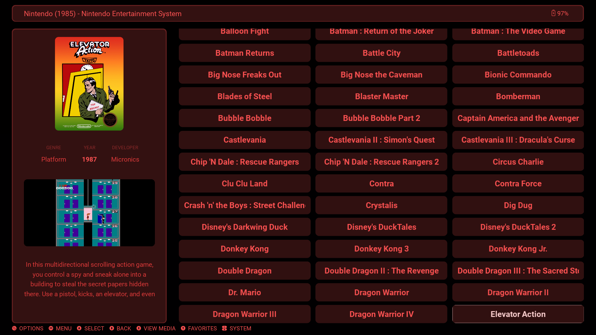

# X-Grid (ES-DE 3.2+)

X-Grid aims at larger libraries. When you have hundreds or thousands of games, you want enough items on screen to move quickly, without the layout feeling cramped or hard to read. Dense enough to browse fast, clear enough to stay comfortable.

**Tested only on Steam Deck with ES-DE 3.4.** Other devices and aspect ratios may work, but they are not verified yet.

## Install

1. Open the theme repository on GitHub.
2. Click the green **Code** button and choose **Download ZIP**.
3. Unzip the archive.
4. Copy the theme folder into `ES-DE/themes/` (that folder must contain `theme.xml` and `capabilities.xml`).
   - On Steam Deck this is typically `/home/deck/ES-DE/themes/`.
   - The `screenshots/` folder is documentation only; you can omit it when copying.
5. Fully restart ES-DE (a reload is not enough after installing or replacing a theme).
6. Go to **UI Settings → Theme** and select **X-Grid**.

## Screenshots

System view — `[System:M]`, Monochrome:

System view — `[System:L]`, Dark Orange:

Game list — `[Game:S]` Marquee (4 columns), Light Orange:

Game list — `[Game:M]` Marquee (3 columns), Pip-Boy:

Game list — `[Game:L]` Marquee (2 columns), Super Game Boy:

Game list — `[Game:M]` Cover (3 columns), Crimson:

## Variants

Use **UI Settings → Theme Variant** to set system/game list sizes and media style. System is M or L; game is S, M, or L; media is Marquee or Cover, each with or without video (24 combinations). Grid columns fill the right panel equally:

| Size | Columns |
|------|---------|
| Game S | 4 |
| Game M / System M | 3 |
| Game L / System L | 2 |

Media options:

- **Marquee** — game logos (wheels) in the info panel title area
- **Cover** — box covers in the same area; metadata and description shift down slightly
- **w/ Video** — physical media art, then video plays (current behavior)
- **wo/ Video** — physical media art only, no video playback

Examples:

- `[System:M] [Game:S] Marquee w/ Video`
- `[System:M] [Game:M] Cover wo/ Video`
- `[System:L] [Game:L] Cover w/ Video`

## Font size

Use **UI Settings → Theme Font Size** (`small` / `medium` / `large`) to scale status, grid, metadata, description, and help text.

## Color schemes

Use **UI Settings → Theme Color Scheme** to pick a palette:

- Monochrome
- Dark Orange (default)
- Dark Gold
- Light Orange
- Pip-Boy
- Pocket Gray
- Super Game Boy
- Crimson
- PlayStation 4
- PlayStation 5
- Xbox 360
- Xbox One
- Switch OLED
- Gamecube
- Indigo
- Purple
- WII

## Bundled assets

These packs ship with the theme and must stay with it:

- `system-logos/system-logo-color/` ([ES-DE system logos](https://gitlab.com/es-de/themes/system-logos))
- `system-metadata/` ([ES-DE system metadata](https://gitlab.com/es-de/themes/system-metadata))
- `system-controllers-outline/` ([ES-DE system controllers](https://gitlab.com/es-de/themes/system-controllers-outline))

Keep these folders when you copy or update the theme.
